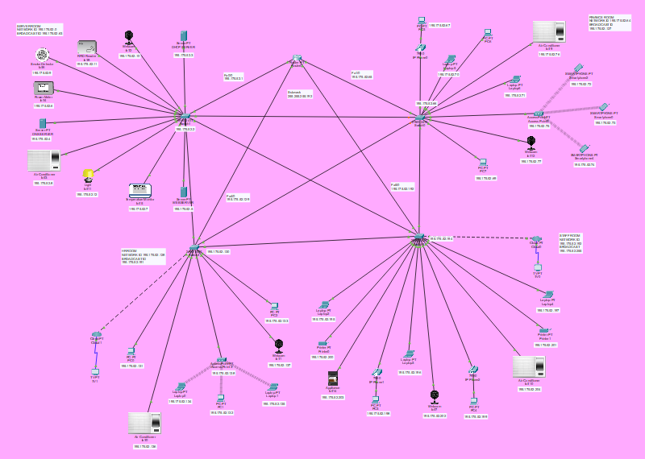

# MapleTech Penang Office — Network Design & Subnetting

**Cisco Packet Tracer | LAN Design | IPv4 Subnetting | Star & Mesh Topologies**

> **Individual contribution to an academic group networking project:** I was responsible for the Penang office network design, IP addressing plan, and related technical justification. The wider MapleTech project also included Kuala Lumpur, Ipoh, and Melaka offices designed by other team members.

## Project Overview

Designed a simulated local area network for MapleTech's **Penang office**, using a hybrid topology to connect departmental workstations, servers, wireless endpoints, and IoT devices. The design combines **star connections for end devices** with **mesh links between switches**, balancing straightforward administration with alternative network paths.

## Network Topology

*Original Penang office topology diagram, Figure 1 in the submitted documentation.*

### Design decisions

- **Star topology:** End devices connect to departmental switches for easier management and fault isolation.
- **Mesh topology:** Interconnected switches provide multiple potential paths and improve resilience.
- **Departmental subnetting:** Separate IPv4 subnets for the server room, Finance, HR, and Staff rooms.
- **Mixed endpoints:** PCs, laptops, smartphones, printers, servers, and IoT devices are represented in the network.

## IPv4 Addressing Plan

The documented Penang address space is based on **195.175.52.0/24**, divided into four **/26** networks with subnet mask `255.255.255.192`.

| Department | Network | Usable host range | Broadcast | Documented gateway |
| --- | --- | --- | --- | --- |
| Server room | `195.175.52.0/26` | `195.175.52.1–62` | `195.175.52.63` | `195.175.52.1` |
| Finance | `195.175.52.64/26` | `195.175.52.65–126` | `195.175.52.127` | `195.175.52.65` |
| HR | `195.175.52.128/26` | `195.175.52.129–190` | `195.175.52.191` | `195.175.52.129` |
| Staff | `195.175.52.192/26` | `195.175.52.193–254` | `195.175.52.255` | `195.175.52.193` |

Each /26 subnet has **64 total addresses and 62 usable host addresses**. The addresses above reproduce the intended network ranges and gateway plan from the report; this is an academic simulation, not a recommendation to deploy this public IPv4 range on a private corporate LAN.

## Simulated Infrastructure

| Area | Examples of documented devices |
| --- | --- |
| Server room | DHCP, DNS and web servers; power meter, temperature monitor, air conditioner, smoke detector, webcam, RFID reader, lighting |
| Finance | PCs, laptops, smartphones, air conditioner, webcam |
| HR | PCs, laptops, air conditioner, webcam |
| Staff | PCs, laptops, printers, webcam, appliance, air conditioner |

## My Responsibilities

1. Developed the **Penang branch network topology** and explained the choice of star and mesh arrangements.
2. Prepared the **IPv4 addressing scheme**, including subnet boundaries, gateways, and endpoint assignments.
3. Documented the design rationale, scalability considerations, and department-level connectivity requirements.
4. Contributed to the wider team's shared documentation and configuration discussion.

## Tools & Concepts

`Cisco Packet Tracer` · `IPv4` · `Subnetting` · `LAN Design` · `Network Topology` · `Routing & Switching` · `DHCP` · `DNS` · `IoT Networking`

## Repository Contents

- `README.md` — project overview and Penang-specific network design
- `penang-network-topology.png` — original topology figure from my report

**Note:** The original `.pkt` Packet Tracer project file was not included in the supplied documentation, so this repository documents the design rather than presenting an executable simulation file. Configuration and end-to-end connectivity should be verified in Packet Tracer before claiming a working deployment.

## Academic Context

- **Module:** Introduction to Networking (`CT043-3-1-IN`)
- **Institution:** Asia Pacific University of Technology & Innovation (APU)
- **Individual Penang office contributor:** Fairouz Abdulrahman Hamed Mousa Abdelmaguid
- **Project scenario:** MapleTech multi-branch office networking

*This repository showcases my individually assigned Penang office work within the original group assignment. It does not claim authorship of the other branches.*
